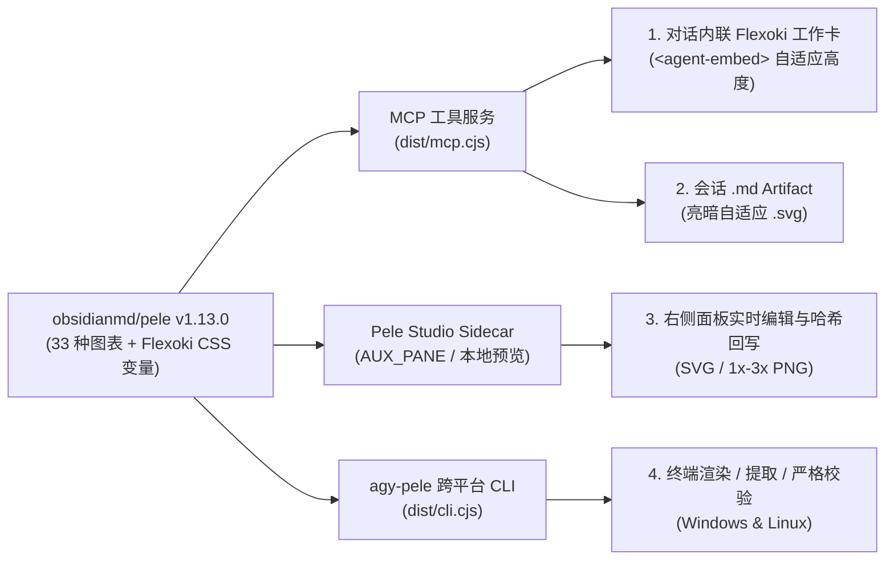

# Antigravity Pele (`antigravity-pele` / `agy-pele`)

[](LICENSE)
[](docs/user-guide/getting-started.md)
[](https://github.com/obsidianmd/pele)
[](docs/user-guide/diagram-types.md)
[](docs/user-guide/getting-started.md)

基于 Obsidian 开源零依赖渲染引擎 [**`obsidianmd/pele`**](https://github.com/obsidianmd/pele) 构建的跨平台（**Windows & Linux**）Google Antigravity 第三方 Mermaid 图表插件与命令行工具，集 **MCP 内联工作卡**、**Pele Studio 右侧工作台**、**三端自动化接管规则** 与 **独立 CLI (`agy-pele`)** 于一体。

[核心特性](#项目背景与核心价值) · [快速安装](#快速安装windows--linux-开箱即用) · [四大形态](#基本使用方式四大形态) · [文档中心](docs/README.md) · [致敬 Obsidian Pele](#致敬与鸣谢obsidian-pele) · [开源协议与署名](#开源协议与署名要求)

---

## 项目背景与核心价值

Google Antigravity 原生内置的 Markdown Mermaid 预览仅覆盖约 6 种基础图表类型。借助 [**Obsidian Pele**](https://github.com/obsidianmd/pele)，`antigravity-pele` 将完整、快速、高颜值的图表工作流引入 Antigravity Desktop、会话文档、项目仓库与本地终端。

| 能力维度 | Antigravity 原生渲染 | Antigravity Pele (`antigravity-pele`) |
| :--- | :--- | :--- |
| **支持图表类型** | 6 种基础类型（flowchart / sequence / class / state / er / xychart） | **33 种图表**（完整 23 种 Mermaid 12.1 + 10 种 Pele 扩展语法） |
| **渲染性能与依赖** | 依赖浏览器 DOM 测量或外部运行时 | **零外部浏览器依赖**，纯同步 `<1ms` 确定性 SVG 布局 |
| **色彩与主题** | 固定默认样式 | 原生 **Flexoki Light / Dark** 暖墨色体系，自动跟随系统与宿主暗黑模式 |
| **内联交互与竖版适配** | 静态预览 | 吸顶常驻工具栏：**视图 / 源码 / 分栏**、缩放拖拽、**自适应高度（竖版长图自动展开）** |
| **实时编辑与导出** | 需手动改源码重渲染 | **Pele Studio 右侧面板**：`<1ms` 实时编辑、SHA-256 防冲突回写、SVG / 1x–3x PNG 导出 |
| **终端与 CI 校验** | 无独立 CLI | 跨平台 **`agy-pele`** CLI：批量渲染、提取、本地预览与 `--strict-mermaid` 语法检查 |

---

## 系统架构总览



---

## 快速安装（Windows & Linux 开箱即用）

仓库已包含预构建的单文件运行产物（`dist/` 与 `sidecars/pele_studio/dist/`），目标机器**无需执行编译或额外安装 Mermaid / Chromium**。启动垫片会自动探测系统 `node`，并在未全局安装 Node.js 时自动回退到 Antigravity 自带的 `agy-node` / `agy-node.exe`。

### Linux（bash / zsh）

```bash
git clone https://github.com/springtian1982/antigravity-pele.git
cd antigravity-pele
node scripts/install.mjs
```

安装脚本会自动完成两件事：
1. 将插件安装至 `~/.gemini/config/plugins/antigravity-pele`。
2. 创建 CLI 软链接 `~/.local/bin/agy-pele`（请确保 `~/.local/bin` 已加入 `$PATH`）。

验证安装：

```bash
agy-pele --version
```

### Windows（PowerShell 或 CMD）

```powershell
git clone https://github.com/springtian1982/antigravity-pele.git
cd antigravity-pele
node scripts/install.mjs
```

安装脚本会自动完成：
1. 将插件安装至 `%USERPROFILE%\.gemini\config\plugins\antigravity-pele`。
2. 在 `%USERPROFILE%\.local\bin`（及存在时的 `%APPDATA%\npm`）生成 `agy-pele.cmd` 与 `agy-pele.ps1` 启动器。

验证安装：

```powershell
agy-pele --version
```

### 卸载

```bash
node scripts/install.mjs --uninstall
```

更多环境配置、无全局 `node` 时使用 `agy-node` 及 `PATH` 排障请见 [安装与快速上手指南](docs/user-guide/getting-started.md)。

---

## 基本使用方式（四大形态）

### 1. 对话内联工作卡（`pele_render_card` + `<agent-embed>`）

启用插件后，在 Antigravity 对话中让 AI 绘制任何图表时，工具会自动调用 `pele_render_card` 生成自包含 Flexoki 卡片并内联展示：

- **吸顶常驻工具栏**：**视图 / 源码 / 分栏**三模式切换、`- / 100% / +` 缩放（或 `Ctrl/Cmd + 滚轮` 缩放，普通滚轮不劫持页面滚动）、一键复制源码、导出 **SVG** 与 **2x PNG**。
- **自适应高度（默认开启 `height: "auto"`）**：根据容器宽度自动计算竖版 / 长图的真实显示高度（默认上限 `1400px`），也可在工具栏点击 **`自适应`** 按钮随时切换自适应与紧凑模式（`<= 416px`），或传入 `height: "compact"` / 指定像素高度（如 `"680"`）。

### 2. Pele Studio 右侧面板（`SIDECAR_UI_ENTRYPOINT_AUX_PANE`）

调用 `pele_open_in_studio` 或点击聊天中的 `[Pele Studio](sidecar://antigravity-pele/pele_studio/)` 链接即可打开右侧工作台：

- 自动扫描并聚合**当前会话图表**与**工作区 `.md` / `.markdown` / `.mmd` / `.mermaid` 文件**。
- 提供 `<1ms` 实时编辑与精确行号诊断、8 种内置 **Scratchpad 草稿模板**、1x / 2x / 3x PNG 导出。
- 修改工作区 Markdown 内嵌图表后，通过 **SHA-256 内容哈希校验 + 原子替换**安全写回源文件（若磁盘文件被外部修改则会以 `409 HASH_CONFLICT` 提示保护，避免覆盖丢失）。

### 3. 三端差异化自动接管（`rules/AGENTS.md` + `skills/pele-mermaid`）

| 载体表面 | 自动路由策略 | 支持图表范围 |
| :--- | :--- | :--- |
| **Chat 对话气泡** | 禁止裸代码块，统一调用 `pele_render_card` 嵌入 `<agent-embed>` 交互工作卡 | 全部 33 种 |
| **会话 `.md` Artifact** | 调用 `pele_render_artifact_svg` 编译为亮暗自适应 `.svg` 图片嵌入 | 全部 33 种 |
| **项目仓库 `.md` 文档** | 保留原生 ```` ```mermaid ```` 代码块确保 GitHub / GitLab / Obsidian 兼容，并通过 `pele_check_markdown` 校验 | 标准 Mermaid 12.1（23 种） |

### 4. 跨平台命令行工具（`agy-pele`）

```bash
# 1. 渲染单个 .mmd 文件为 Flexoki 自适应 SVG
agy-pele render diagram.mmd -o diagram.svg

# 2. 通过标准输入管道生成独立交互 HTML 工作卡（竖版自适应高度）
cat flow.mmd | agy-pele render -f html -o card.html --theme flexoki --height auto

# 3. 检查整个项目 Markdown 中的 Mermaid 语法与 GitHub 兼容性
agy-pele check README.md docs/ --strict-mermaid

# 4. 从长文档批量提取所有 Mermaid 图表为 SVG（并输出 manifest.json）
agy-pele extract docs/design.md -o ./assets/diagrams -f svg

# 5. 在浏览器中打开本地实时热更新预览工作台
agy-pele preview README.md --watch
```

---

## 文档中心 (`docs/`)

面向**普通用户**和**开发者 / 贡献者**的完整文档位于 [`docs/`](docs/README.md)：

### 面向普通用户
- [安装与快速上手](docs/user-guide/getting-started.md) — Windows / Linux 安装、`agy-node` 回退、插件启用与 `PATH` 配置
- [内联工作卡与 Pele Studio 使用指南](docs/user-guide/chat-and-studio.md) — 工具栏功能、竖版自适应高度、源码回写与高分辨率导出
- [`agy-pele` 命令行完全手册](docs/user-guide/cli-reference.md) — `render` / `check` / `extract` / `preview` 全参数与 CI 集成示例
- [33 种支持图表图鉴与语法速查](docs/user-guide/diagram-types.md) — 23 种 Mermaid 12.1 + 10 种 Pele 扩展语法全景参考

### 面向开发者与贡献者
- [系统架构与内部原理](docs/developer-guide/architecture.md) — 核心模块设计、MCP `_meta` 路由、Sidecar 安全模型、自适应高度引擎与构建产物
- [本地开发、测试与贡献指南](docs/developer-guide/contributing.md) — 构建脚本、单元测试、`agy plugin validate` 严格校验与 PR 规范

---

## 致敬与鸣谢：Obsidian Pele

本项目能够诞生，首先要由衷致敬 **[Steph Ango (`@kepano`)](https://github.com/kepano)** 与 **[Obsidian](https://obsidian.md)** 团队，感谢他们打造并开源了极其优雅的图表渲染库 **[Obsidian Pele (`obsidianmd/pele`)](https://github.com/obsidianmd/pele)**（文档与演练场：**[pele.run](https://pele.run)**）以及 **[Flexoki](https://stephango.com/flexoki)** 配色体系：

- **零依赖同步渲染哲学**：Pele 摆脱了传统渲染器对重型浏览器 DOM 布局的依赖，在 Node.js 与轻量 WebView 中都能以 `<1ms` 输出高质量 SVG，使 CLI、MCP Server 与内联工作卡可以共享完全一致的渲染内核。
- **CSS 变量驱动的暖墨色彩**：依托 Pele 原生的 `--pele-*` 变量架构与 Flexoki 色板，图表可以在无需重绘 SVG 的前提下平滑适配暗黑与浅色主题。
- **丰富的表达力扩展**：在完整兼容 Mermaid 12.1（23 类标准图表）的同时，Pele 原生拓展了 `swimlane-beta`、`agentflow-beta`、`railroad-ebnf-beta`、`venn-beta`、`cynefin-beta`、`ishikawa`、`wardley-beta`、`treeView-beta`、`usecase-beta` 与 `eventmodeling` 共 10 种工程与架构表达图谱。

> 再次向 `obsidianmd/pele` 作者 [`@kepano`](https://github.com/kepano) 致以诚挚敬意！如果你喜欢本插件的渲染效果，欢迎前往 [https://github.com/obsidianmd/pele](https://github.com/obsidianmd/pele) 为上游项目点亮 Star。

---

## 开源协议与署名要求

本项目基于 **[MIT License](LICENSE)** 开源：

```text
Copyright (c) 2026 springtian <springtian@gmail.com>
```

- **社区自由使用与商用**：欢迎个人、社区与商业机构自由使用、复制、修改、合并、发布、分发与商用本项目。
- **修改与商用署名要求**：无论直接商用、再分发，或在本项目代码与产物基础上进行修改和二次开发，**均须在副本或衍生作品的显著位置保留原作者版权与署名声明（`Copyright (c) 2026 springtian <springtian@gmail.com>`）及完整的 [LICENSE](LICENSE) 许可声明**。
- **第三方组件声明**：预构建发行产物内联了 MIT / ISC 许可的上游组件（包括 `obsidianmd/pele`），详情请见 [THIRD_PARTY_NOTICES.md](THIRD_PARTY_NOTICES.md)。
