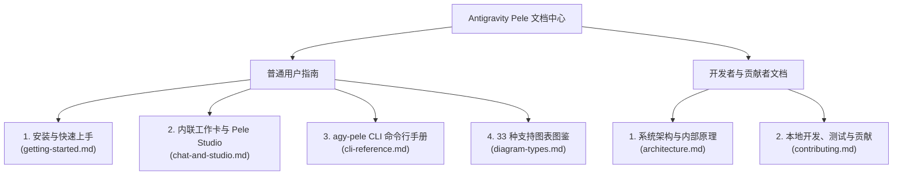

# Antigravity Pele 文档中心

欢迎查阅 **Antigravity Pele (`antigravity-pele` / `agy-pele`)** 文档库。文档按读者角色分为**普通用户指南**与**开发者文档**两条路径。

---

## 面向普通用户（User Guide）

如果你希望在 Antigravity Desktop（Windows / Linux）或终端中快速启用、绘制、编辑、校验与导出 Mermaid 图表，请从这里开始：

| 文档 | 内容摘要 | 适合场景 |
| :--- | :--- | :--- |
| [安装与快速上手](user-guide/getting-started.md) | Windows / Linux 安装步骤、`agy-node` 回退机制、启用插件与 `PATH` 排障 | 首次安装与环境配置 |
| [内联工作卡与 Pele Studio 指南](user-guide/chat-and-studio.md) | 对话卡片交互、竖版自适应高度、Studio 实时编辑与 SHA-256 哈希回写 | 日常绘图、调优与导出 |
| [`agy-pele` 命令行完全手册](user-guide/cli-reference.md) | `render` / `check` / `extract` / `preview` 全命令、参数表与 CI/Git Hook 集成 | 终端批处理与自动化检查 |
| [33 种支持图表图鉴](user-guide/diagram-types.md) | 23 种 Mermaid 12.1 + 10 种 Pele 扩展语法分类表与已验证示例 | 查阅图表类型与编写语法 |

---

## 面向开发者与贡献者（Developer Guide）

如果你计划阅读源码、扩展工具能力、参与贡献或在企业内网定制发行版，请阅读：

| 文档 | 内容摘要 | 适合场景 |
| :--- | :--- | :--- |
| [系统架构与内部原理](developer-guide/architecture.md) | 4 大形态组件通信、渲染流水线、自适应高度计算、MCP `_meta` 路由与 Sidecar 安全模型 | 架构研读与深度集成 |
| [本地开发、测试与贡献指南](developer-guide/contributing.md) | 源码编译（`esbuild`）、TypeScript 检查、`node --test` 单测、`agy plugin validate` 与 PR 检查清单 | 二次开发与提交贡献 |

---

## 相关链接

- **项目仓库**：[springtian1982/antigravity-pele](https://github.com/springtian1982/antigravity-pele)
- **上游渲染引擎**：[obsidianmd/pele](https://github.com/obsidianmd/pele) · [pele.run](https://pele.run)
- **开源协议**：[MIT License](../LICENSE) · [Third-Party Notices](../THIRD_PARTY_NOTICES.md)
