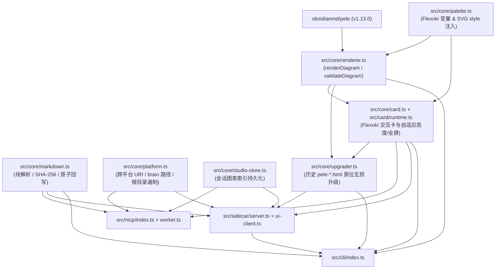
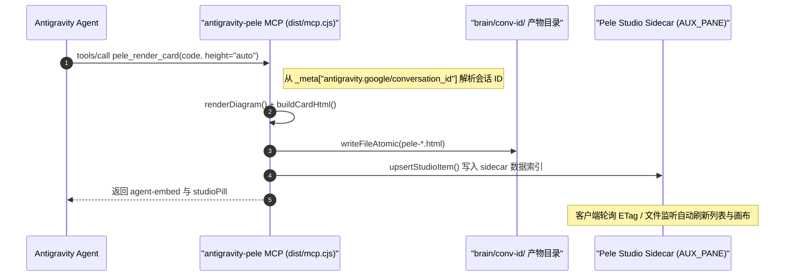

# 系统架构与内部原理

本文档面向希望深入理解、扩展或集成 `antigravity-pele` 源码的开发者，介绍四大运行形态如何共用统一的 Pele 渲染与主题内核。

---

## 1. 目录结构

```text
antigravity_pele/
├── plugin.json                # Antigravity 插件清单（MCP / Rule / Skill / Sidecar 元数据）
├── mcp_config.json            # MCP stdio 服务器启动定义（node dist/mcp.cjs）
├── package.json               # npm 包、构建脚本与 MIT 开源元数据
├── LICENSE / THIRD_PARTY_NOTICES.md
├── assets/logo.svg            # 插件徽章图标
├── bin/
│   ├── agy-pele               # POSIX 启动垫片（含 readlink 循环解析软链接，回退 agy-node）
│   ├── agy-pele.cmd           # Windows CMD 启动垫片（node -> agy-node.exe 回退）
│   └── agy-pele.ps1           # Windows PowerShell 启动垫片
├── rules/AGENTS.md            # Antigravity 全局行为接管规则（启用插件即自动激活）
├── skills/pele-mermaid/       # Agent 技能说明书（SKILL.md）
├── sidecars/pele_studio/      # 右侧 AUX_PANE Sidecar 静态资源与构建产物
│   ├── sidecar.json
│   ├── index.html
│   ├── styles.css
│   └── dist/{server.mjs,ui.js}
├── dist/                      # 预构建运行产物（CLI、MCP 路由/Worker、Card Runtime）
│   ├── cli.cjs
│   ├── mcp.cjs
│   ├── mcp-worker.cjs
│   └── card-runtime.js
├── scripts/
│   ├── build.mjs              # esbuild 多入口单文件打包流水线
│   ├── build-tests.mjs        # 测试套件构建脚本（输出至 .test-dist/）
│   └── install.mjs            # Windows & Linux 全局原子安装 / 历史卡片升级 / 卸载脚本
├── src/
│   ├── core/                  # 渲染、主题、Markdown 块提取、校验、历史卡片原位升级、存储、路径安全
│   ├── card/runtime.ts        # 嵌入在 HTML 工作卡中的零依赖浏览器端交互运行时
│   ├── mcp/                   # 热重载 JSON-RPC 2.0 MCP 路由（index.ts）与工具实现体（worker.ts）
│   ├── sidecar/               # Sidecar 双模 HTTP 后端（server.ts）与 Studio UI 客户端（ui-client.ts）
│   └── cli/index.ts           # agy-pele CLI 入口
├── docs/                      # 用户与开发者文档库
└── tests/                     # 自动化单元与端到端集成测试
```

---

## 2. 模块依赖与交互流

### 组件依赖图



### 对话工具调用与 Studio 联动时序



---

## 3. 核心设计深入解析

### 3.1 渲染与诊断引擎 (`src/core/renderer.ts`)

1. **类型探测增强**：针对上游 `pele.parse()` 对部分扩展图（如 `swimlane-beta`）可能回退标记 `model.type = 'flowchart'` 的情况，渲染与校验阶段均优先采信 `detectType(normalized) ?? res.type`。
2. **换行符归一化**：先将 `\r\n` 统一转为 `\n`，防止 Windows 与 Linux 下词法行号不一致。
3. **宿主 Markdown 行号映射**：`validateDiagram` 捕获 `PeleError` 后，将图表块内部的相对 `err.line` 与代码块起始行 `lineOffset` 相加（`lineOffset + relativeLine - 1`），精确报出宿主 `.md` 中的真实行号。
4. **`--strict-mermaid` 兼容检查**：通过 `PELE_EXCLUSIVE_TYPES` 集合识别 10 种 Pele 专属图谱，当在公共 Markdown 中开启 `strictMermaid: true` 时发出 `warning [pele-exclusive-diagram]`。

### 3.2 Flexoki 变量主题系统 (`src/core/palette.ts`)

- 内置 `FLEXOKI_LIGHT`、`FLEXOKI_DARK` 与 `HOST_BRIDGE_VARS` 三组变量映射，所有变量作用域严格限定于容器选择器（如 `#pele-card`、`svg`），**绝不污染宿主全局 `:root`**。
- **独立 SVG 亮暗自适应**：`injectStandaloneSvgTheme()` 会向导出或 Artifact `.svg` 根元素注入背景圆角矩形与 `<style>` 媒体查询 `@media (prefers-color-scheme: dark)`，使同一个 `.svg` 文件在亮色与暗黑查看器中均能正确反色。
- **工作卡运行时同步**：`observeHostAndSystemTheme()`（`src/core/svg-export-client.ts`）同时监听系统 `prefers-color-scheme` 与宿主 `data-resolved-theme` / `:root.dark` / `.light` 属性变化。

### 3.3 宽度感知的自适应高度引擎 (`src/core/card.ts` & `src/card/runtime.ts`)

为解决竖版图表在固定高度容器中被缩小或裁切的问题，卡片采用三层高度计算策略：

1. **编译期初算 (`buildCardHtml`)**：基于参考宽度（内联 `620px` / 独立页面 `960px`）与 `widthScale = clamp(0.2, 1, (stageWidth - 24) / svgWidth)` 计算 `estNaturalHeight`，写入内嵌元数据 `<script id="pele-card-meta">`。
2. **运行时实测 (`syncWorkspaceHeight`)**：浏览器加载后及 `ResizeObserver` 监听到卡片宽度变化时，按实际舞台宽度计算 `naturalDiagramHeight = ceil(meta.height * widthScale + 28)`，按模式设定 `#pele-workspace` 高度：
   - `auto`（默认）：`clamp(120, maxAutoHeight, naturalDiagramHeight)`（内联默认上限 `1400px`，独立页 `2400px`）；切到源码视图时基于 `codeEl.scrollHeight` 自适应。
   - `compact`：`clamp(140, 416, naturalDiagramHeight)`。
   - `fixed`：使用传入的 `120–4000px` 固定值。
3. **交互细节**：
   - 工具栏使用 `position: sticky; top: 0` 常驻顶栏，`#pele-height-toggle` 按钮支持实时一键切换 `auto` / `compact`。
   - 为避免出现滚动条时引起 `<=20px` 的宽度震荡循环，`ResizeObserver` 过滤了单次窄幅抖动。
   - 普通鼠标滚轮保留给外层页面滚动，仅 `Ctrl` / `Cmd + 滚轮` 触发画布缩放。

### 3.4 热重载 MCP Stdio 服务器 (`src/mcp/index.ts` & `src/mcp/worker.ts`)

- **零外部 MCP SDK 依赖 + 路由/Worker 分离**：`dist/mcp.cjs` 仅保留轻量的 JSON-RPC 2.0 stdio 分发外壳（`initialize`、`ping`、`tools/list`、`tools/call`），核心工具与 `pele` 引擎位于 `dist/mcp-worker.cjs`。
- **自动热重载与失效兜底**：`mcp.cjs` 每次调用前对比 `mcp-worker.cjs` 的 `mtimeMs`，文件变更即清理 `require.cache` 原地重载并发送 `notifications/tools/list_changed`；同时支持在当前目录失效时自动回退定位 `~/.gemini/config/plugins/antigravity-pele/dist/mcp-worker.cjs`，配合 `scripts/install.mjs` 的原地原子替换避免升级后常驻进程长期停留在旧版本。
- **会话 ID 提取**：优先从 `params._meta["antigravity.google/conversation_id"]` 读取当前会话 ID，其次检查参数或环境变量 `ANTIGRAVITY_CONVERSATION_ID`，从而准确把生成的文件写入 `~/.gemini/antigravity/brain/<conv-id>/`。

### 3.5 Sidecar 双模后端与安全机制 (`src/sidecar/server.ts` & `src/core/markdown.ts`)

Pele Studio 后端根据运行环境在两种模式间自动切换：
- **Antigravity Sidecar 模式**：引入 `sidecar_sdk`，按平台规范响应 `SIDECAR_PORT` 与 WebView 请求，动态同步 `onWorkspaceChange` 工作区 URI。
- **CLI 独立预览模式 (`agy-pele preview`)**：仅绑定 `127.0.0.1`，生成 `24 字节` 随机访问口令（要求查询参数或 `X-Pele-Token` 请求头验证，防止本地跨站请求伪造 CSRF），并结合 `fs.watch` 与客户端 `ETag` 轮询实现增量刷新。

写回磁盘（`POST /api/save`）严格执行四道安全防线：
1. **根目录遏制 (`isPathInsideAllowedRoots`)**：使用 `fs.realpathSync` 解析符号链接后，确认目标路径严格位于当前工作区或 Antigravity `brain/` 目录之内。
2. **渲染前语法校验**：保存前先调用 `renderDiagram(newCode)`，语法非法直接返回 HTTP `400`。
3. **SHA-256 乐观并发锁 (`HashConflictError`)**：`replaceMermaidBlockInFile()` 在替换前核对代码块内容前 16 位 SHA-256 哈希；若磁盘文件已被修改则返回 HTTP `409 (HASH_CONFLICT)`。
4. **EOL 保留与原子写入 (`writeFileAtomic`)**：保留原文件 `CRLF` 或 `LF` 换行格式及原始围栏缩进，写入同目录临时文件后通过 `fs.renameSync` 原子替换。

---

## 4. 跨平台预构建与垫片链路 (`scripts/build.mjs`)

每次运行 `npm run build`，`esbuild` 会并行产出自包含运行产物，使终端用户无需 `node_modules/` 即可运行：

| 入口源码 | 输出产物 | 目标平台 / 格式 | 说明 |
| :--- | :--- | :--- | :--- |
| `src/card/runtime.ts` | `dist/card-runtime.js` | Browser IIFE（压缩） | 内联注入到每个生成的卡片 HTML `<script>` 中 |
| `src/cli/index.ts` | `dist/cli.cjs` | Node 20 CJS | `agy-pele` CLI 主程序，含 `#!/usr/bin/env node` |
| `src/mcp/index.ts` | `dist/mcp.cjs` | Node 20 CJS | 轻量热重载 MCP stdio 路由外壳（监听 `mcp-worker.cjs` 变更） |
| `src/mcp/worker.ts` | `dist/mcp-worker.cjs` | Node 20 CJS | MCP 工具实现体与内联 `pele` 引擎 |
| `src/sidecar/server.ts` | `sidecars/pele_studio/dist/server.mjs` | Node 20 ESM | Sidecar 后端（`external: ['sidecar_sdk']`） |
| `src/sidecar/ui-client.ts` | `sidecars/pele_studio/dist/ui.js` | Browser IIFE（压缩） | 内联 `pele` 全量渲染引擎的 Studio 前端脚本 |
