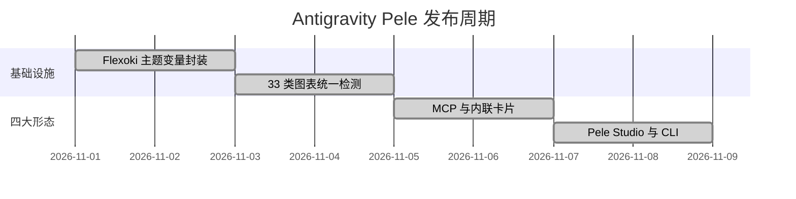
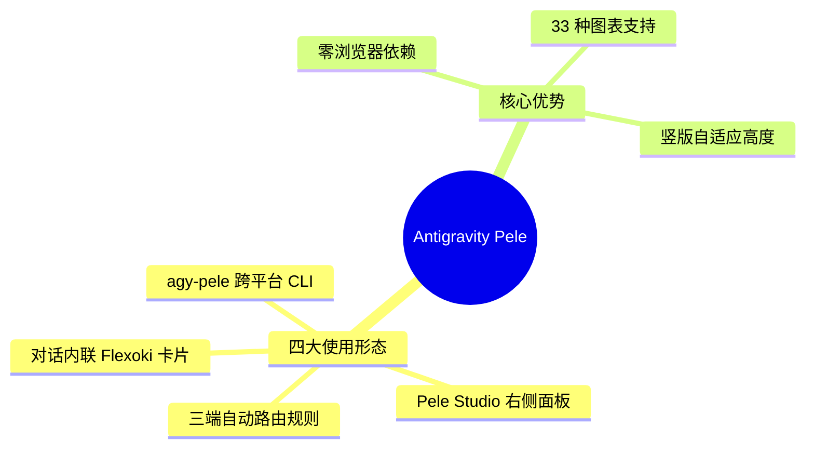
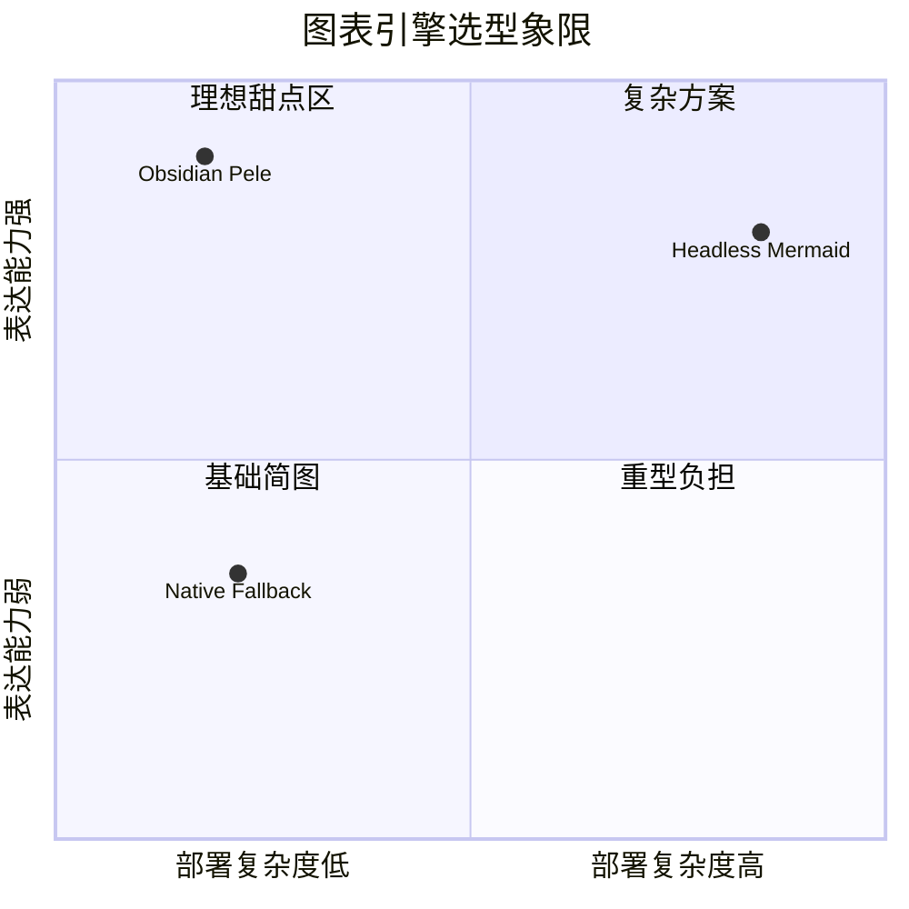

# 33 种支持图表图鉴与语法速查

得益于底层 [`obsidianmd/pele`](https://github.com/obsidianmd/pele) 引擎，`antigravity-pele` 完整支持 **33 种图表语法**：
- **6 种** Antigravity 原生支持的基础类型（由 Pele 接管后获得 `<1ms` Flexoki 渲染与交互工具栏）。
- **17 种** Antigravity 原生缺失的标准 **Mermaid 12.1** 图表类型。
- **10 种** **Pele 专属扩展图表类型**（适合代理流程、架构分析、泳道与因果分析）。

---

## 完整支持矩阵

### 第一组：Antigravity 原生基础类型（6 种 — 全表面兼容）

| 引擎类型 (`type`) | 开头关键字 | 适用场景 | 仓库 `.md` 原生兼容 |
| :--- | :--- | :--- | :--- |
| `flowchart` | `flowchart TD` / `graph LR` | 流程图、系统结构、决策分支 | 是 |
| `sequence` | `sequenceDiagram` | 时序交互、API 调用、RPC 链路 | 是 |
| `class` | `classDiagram` | 面向对象类关系、接口继承 | 是 |
| `state` | `stateDiagram-v2` | 状态机流转、生命周期 | 是 |
| `er` | `erDiagram` | 数据库表关系（E-R 图） | 是 |
| `xychart` | `xychart-beta` | 柱状图与折线指标图 | 是 |

### 第二组：Pele 补齐的 Mermaid 12.1 标准图表（17 种 — 全表面兼容）

| 引擎类型 (`type`) | 开头关键字 | 适用场景 | 仓库 `.md` 原生兼容 |
| :--- | :--- | :--- | :--- |
| `gantt` | `gantt` | 项目排期与里程碑甘特图 | 是 |
| `mindmap` | `mindmap` | 知识树与思维导图 | 是 |
| `timeline` | `timeline` | 历史演进与版本时间线 | 是 |
| `pie` | `pie` | 占比分布饼图 | 是 |
| `git` | `gitGraph` | Git 分支合并演进图 | 是 |
| `journey` | `journey` | 用户体验旅程图 | 是 |
| `quadrant` | `quadrantChart` | 四象限优先级/评估矩阵 | 是 |
| `requirement` | `requirementDiagram` | 需求可追溯关系图 | 是 |
| `c4` | `C4Context` / `C4Container` | C4 软件架构分层图 | 是 |
| `sankey` | `sankey-beta` | 流量/预算桑基流向图 | 是 |
| `block` | `block-beta` | 网格化模块方框布局图 | 是 |
| `packet` | `packet-beta` | 网络协议报文与比特字段布局图 | 是 |
| `kanban` | `kanban` | 任务看板列视图 | 是 |
| `architecture` | `architecture-beta` | 云原生服务与网关架构图 | 是 |
| `radar` | `radar-beta` | 多维能力评估雷达图 | 是 |
| `treemap` | `treemap-beta` | 层级面积矩形树图 | 是 |
| `info` | `info` | 引擎元信息视图 | 是 |

### 第三组：Pele 专属扩展图表（10 种 — 对话卡片 / SVG Artifact / Studio / CLI 专用）

> **兼容提示**：以下 10 种类型是 Pele 的强力扩展，在 **对话内联卡片、会话 SVG Artifact、Pele Studio 及 `agy-pele` CLI** 中均可直接渲染；但在需要同步展示到 GitHub / GitLab 的仓库 `.md` 文件中时，建议避免放进 ```` ```mermaid ```` 块（否则 `agy-pele check --strict-mermaid` 会提醒兼容警告），可改为通过 `agy-pele render` 导出 `.svg` 后以图片嵌入，或使用 ```` ```mmd ```` 围栏仅作源码示例。

| 引擎类型 (`type`) | 开头关键字 | 核心用途 |
| :--- | :--- | :--- |
| `swimlane` | `swimlane-beta` | 跨角色/跨服务跨道泳道图 |
| `agentflow` | `agentflow-beta` | AI Agent 规划/工具调用编排流 |
| `railroad` | `railroad-ebnf-beta` | EBNF 语法铁路轨道图 |
| `venn` | `venn-beta` | 集合交并集维恩图 |
| `cynefin` | `cynefin-beta` | Cynefin 复杂度决策域矩阵 |
| `ishikawa` | `ishikawa` | 鱼骨图 / 根因分析图 |
| `wardley` | `wardley-beta` | Wardley 演进价值链地图 |
| `treeView` | `treeView-beta` | 文件系统/配置层级目录树 |
| `usecase` | `usecase-beta` | UML 用例图（参与者与用例） |
| `eventmodeling` | `eventmodeling` | DDD 事件建模时间线（UI / Cmd / Evt / Rmo） |

---

## 常见标准 Mermaid 12.1 图表示例

以下示例使用标准 ```` ```mermaid ```` 围栏编写，可在 GitHub 与 Antigravity Pele 中同时渲染。

### 1. 甘特图 (`gantt`)



### 2. 思维导图 (`mindmap`)



### 3. 四象限评估 (`quadrantChart`)



---

## 10 种 Pele 专属扩展图表示例（已通过 `pele.parse` 校验）

以下示例均经过当前内核 `pele@1.13.0` 解析验证，可直接粘贴至对话中让助手用 `pele_render_card` 渲染，或写入 `.mmd` 文件交由 `agy-pele render` 输出 SVG / HTML：

### 1. 泳道图 (`swimlane-beta`)

```mmd
swimlane-beta LR
  subgraph User
    A[发起需求] --> B[审阅自适应卡片]
  end
  subgraph Agent
    A --> C[调用 pele_render_card]
    C --> B
  end
```

### 2. Agent 编排流 (`agentflow-beta`)

```mmd
agentflow-beta
  prompt[用户提问] --> planner[规划器]
  planner --> mcp[antigravity-pele MCP]
  mcp --> card[内联 Flexoki 工作卡]
```

### 3. EBNF 语法铁路图 (`railroad-ebnf-beta`)

```mmd
railroad-ebnf-beta
  command = "agy-pele" , ( "render" | "check" | "extract" | "preview" ) , { option } ;
```

### 4. 维恩图 (`venn-beta`)

```mmd
venn-beta
  set A["Mermaid 12.1 (23)"]
  set B["Pele Extended (10)"]
  union A,B["33 Diagram Types"]
```

### 5. Cynefin 决策矩阵 (`cynefin-beta`)

```mmd
cynefin-beta
  clear "已知因果：直接套用标准模板"
  complicated "专家分析：评估依赖与架构"
  complex "探索试错：原型与快速反馈"
  chaotic "应急止损：先稳态后复盘"
```

### 6. 鱼骨根因图 (`ishikawa`)

```mmd
ishikawa
  effect 竖版图表阅读体验差
    cause 容器固定高度
      detail 超过 416px 被截断或等比过小
    cause 滚轮冲突
      detail 卡片劫持外层文档滚动
```

### 7. Wardley 演进图 (`wardley-beta`)

```mmd
wardley-beta
  title AI Diagram Value Chain
  anchor Developer [0.95, 0.65]
  component Inline Card [0.80, 0.55]
  component Pele Engine [0.45, 0.78]
  Developer -> Inline Card
  Inline Card -> Pele Engine
```

### 8. 目录树 (`treeView-beta`)

```mmd
treeView-beta
  "antigravity-pele"
    "src/"
      "core/"
      "mcp/"
      "sidecar/"
      "cli/"
    "docs/"
```

### 9. UML 用例图 (`usecase-beta`)

```mmd
usecase-beta
  actor Developer
  Developer --> "Render Card"
  Developer --> "Edit in Pele Studio"
```

### 10. 事件建模 (`eventmodeling`)

```mmd
eventmodeling
  tf 01 ui ChatUI
  tf 02 cmd RenderCard ->> 01
  tf 03 evt CardRendered ->> 02
  tf 04 rmo CardEmbedView ->> 03
```
